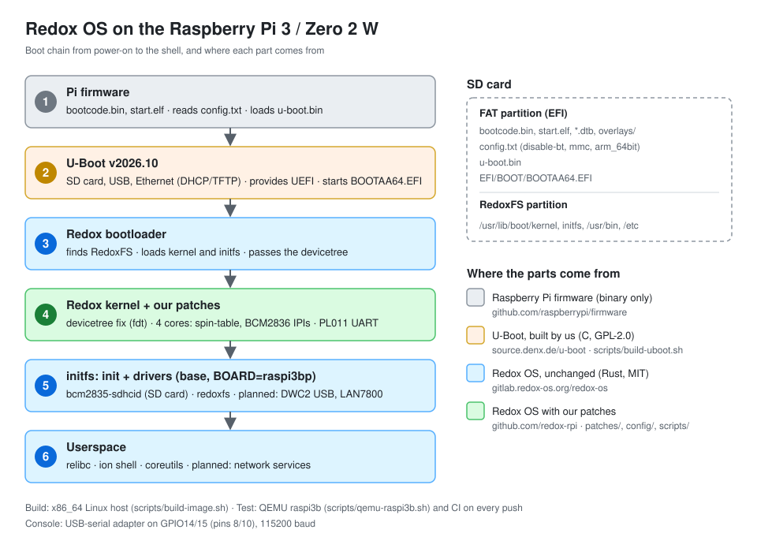

# Architecture

Booting Redox on a Raspberry Pi takes six stages. Each one prepares the
hardware a bit further and hands over to the next.

## 1. Raspberry Pi firmware

Closed-source firmware from Raspberry Pi Ltd. It runs on the VideoCore GPU,
not on the ARM cores, initializes RAM and clocks, and reads `config.txt` from
the FAT partition of the SD card. With `arm_64bit=1` and
`kernel=u-boot.bin` it starts U-Boot on the ARM cores in 64-bit mode.

It also loads the board's devicetree (`bcm2710-rpi-*.dtb`), applies the
overlays named in `config.txt` and hands the result over. Two overlays matter
for Redox:

- `dtoverlay=disable-bt` moves the PL011 UART from Bluetooth to GPIO14/15, so
  the serial console uses the UART Redox supports.
- `dtoverlay=mmc` connects the SD card to the Arasan controller, the one the
  Redox SD driver supports (by default it uses the `sdhost` controller).

The three extra cores stay parked in a spin-table loop until the OS writes an
entry address to their release address (`0xe0`, `0xe8`, `0xf0`).

Source: [raspberrypi/firmware](https://github.com/raspberrypi/firmware).

## 2. U-Boot

[U-Boot](https://docs.u-boot.org) is a bootloader for embedded boards,
written in C and licensed under GPL-2.0. It is not part of Redox. On the Pi it
brings up the SD card, USB and Ethernet, and provides a **UEFI** environment.
That is what lets Redox boot on the Pi the same way it boots on ARM servers or
QEMU: the Redox bootloader is a UEFI program.

We build U-Boot v2026.10 ourselves with
[`scripts/build-uboot.sh`](../scripts/build-uboot.sh):
`rpi_arm64_defconfig` (one binary for Pi 3, 3B+ and Zero 2 W, devicetree
taken from the firmware) plus [`config/u-boot.config`](../config/u-boot.config)
(DHCP/TFTP, USB Ethernet drivers, `blkmap` for booting an image from RAM).
Network boot from the build server is planned.

Redox's own setup uses a prebuilt U-Boot 2022.07 with an embedded Pi 3B
devicetree, which does not fit the Zero 2 W.

## 3. Redox bootloader

A UEFI program written in Rust (`EFI/BOOT/BOOTAA64.EFI`). It finds the
RedoxFS partition, loads the kernel and the initfs, and passes the devicetree
it got from U-Boot. In live mode it copies the whole filesystem into RAM
first.

Source: [redox-os/bootloader](https://gitlab.redox-os.org/redox-os/bootloader), unchanged.

## 4. Redox kernel

A microkernel written in Rust. It reads the devicetree to find the interrupt
controllers, timer and UART, sets up memory and starts the other cores. Our
patches ([`patches/`](../patches/)):

- **fdt fix:** the devicetree library looked for interrupt parents in the
  wrong place, which made the kernel panic on every Pi devicetree.
- **SMP:** starting cores through spin-table, and IPIs through the BCM2836
  mailboxes, since the Pi has neither PSCI nor a GIC.

The kernel only contains what every board needs. Everything else runs as a
user-space driver.

Source: [redox-os/kernel](https://gitlab.redox-os.org/redox-os/kernel) + our patches.

## 5. initfs: init and drivers

A small filesystem loaded together with the kernel. `init` starts the drivers
needed to reach the real root filesystem. On the Pi that is
`bcm2835-sdhcid` (SD card) and `redoxfs`. Board-specific drivers only start in
images built with `BOARD=raspi3bp`.

Planned: a DWC2 USB host driver, USB hub support and Ethernet drivers
(LAN7800 for the Pi 3B+, the HAT's chip for the Zero 2 W).

Source: [redox-os/base](https://gitlab.redox-os.org/redox-os/base).

## 6. Userspace

Everything else: `relibc` (the C library), the `ion` shell, coreutils, and
later network services. Most programs come as Redox's prebuilt aarch64
packages.

## Build and test

| What | Where | How |
|---|---|---|
| Kernel only | macOS or Linux | [`scripts/build-kernel.sh`](../scripts/build-kernel.sh) |
| Full image | x86_64 Linux | [`scripts/build-image.sh`](../scripts/build-image.sh), see [build host](build-host.md) |
| U-Boot | x86_64 Linux | [`scripts/build-uboot.sh`](../scripts/build-uboot.sh) |
| Boot test | macOS or Linux | [`scripts/qemu-raspi3b.sh`](../scripts/qemu-raspi3b.sh), see [testing](testing.md) |
| CI | GitHub Actions | Kernel build and QEMU boot test on every push and daily |
