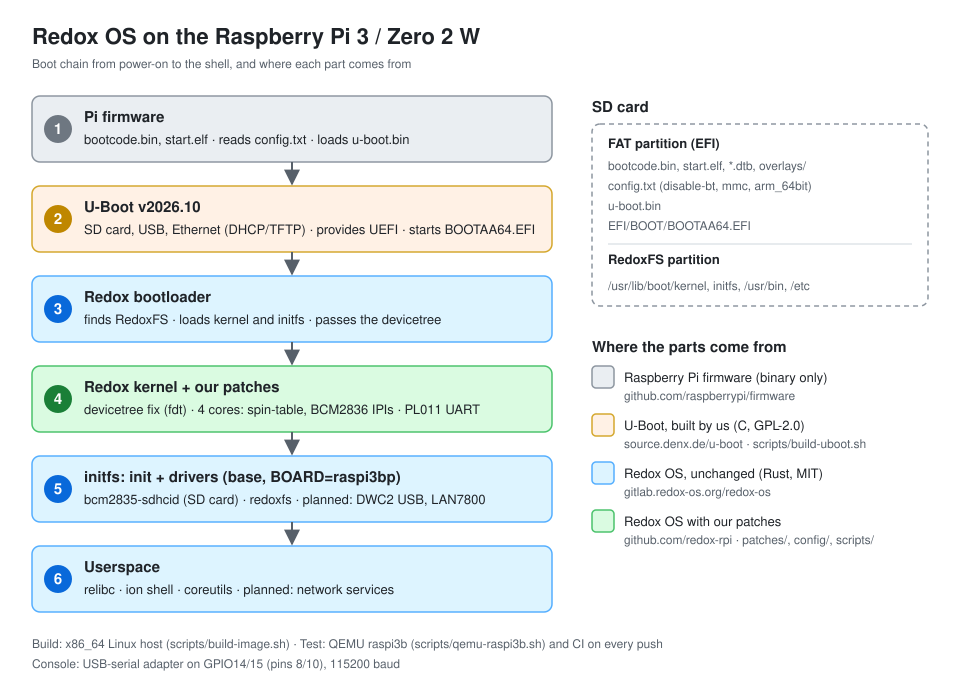

# Architecture

Booting Redox on a Raspberry Pi takes six stages. Each one prepares the
hardware a bit further and hands over to the next.

## 1. Raspberry Pi firmware

Closed-source firmware from Raspberry Pi Ltd. It runs on the VideoCore GPU,
not on the ARM cores, initializes RAM and clocks, and reads `config.txt` from
the FAT partition of the SD card. With `arm_64bit=1` and
`kernel=u-boot.bin` it starts U-Boot on the ARM cores in 64-bit mode.

It also loads the board's devicetree (`bcm2710-rpi-*.dtb`), applies the
overlays named in `config.txt` and hands the result over. Two overlays matter
for Redox:

- `dtoverlay=disable-bt` moves the PL011 UART from Bluetooth to GPIO14/15, so
  the serial console uses the UART Redox supports.
- `dtoverlay=mmc` connects the SD card to the Arasan controller, the one the
  Redox SD driver supports (by default it uses the `sdhost` controller).

The three extra cores stay parked in a spin-table loop until the OS writes an
entry address to their release address (`0xe0`, `0xe8`, `0xf0`).

Source: [raspberrypi/firmware](https://github.com/raspberrypi/firmware).

### What runs where

The Pi has two kinds of processor: the **VideoCore VPU** (the "GPU" side,
which starts first and owns the clocks and memory set-up) and the four
**ARM Cortex-A53** cores, where Redox runs. Stage 1 is really four pieces:

| # | Piece | Runs on | Where it comes from | What it does | Open replacement ([open-firmware.md](topics/open-firmware.md)) |
|---|---|---|---|---|---|
| 1a | Boot ROM | VPU | burnt into the SoC | reads the OTP, looks for `bootcode.bin` on the SD card, USB or the network (the 3B+ has network boot in ROM) | none, it stays |
| 1b | `bootcode.bin` | VPU, in the 128 KB L2 cache | FAT partition or TFTP | starts SDRAM, loads `start*.elf` and `fixup*.dat` | rpi-open-firmware, lk-overlay stage 1 |
| 1c | `start*.elf` + `fixup*.dat` | VPU, in SDRAM (an RTOS, ThreadX) | FAT partition or TFTP | reads `config.txt`, sets the PLLs and clocks (what `socdump` reads), splits memory (`gpu_mem`), sets up HDMI and the framebuffer, loads the devicetree, overlays and `u-boot.bin`, then releases the ARM. **Keeps running** as long as the Pi is on: mailbox service for `rpi-firmwared`, `rpi-fbd`, clocks, temperature, throttling | lk-overlay stage 2 (with a small mailbox service) |
| 1d | armstub (`armstub8`) | ARM, EL3 | built into `start*.elf` | timer frequency, SMP bit, EL3 to EL2, parks cores 1–3 in the spin table (release addresses `0xe0`, `0xe8`, `0xf0`) | [`armstub8.S`](https://github.com/raspberrypi/tools/blob/master/armstubs/armstub8.S) (BSD) or TF-A BL31 |
| 2–6 | U-Boot, Redox bootloader, kernel, userspace | ARM | our image | below | unchanged |

`start*.elf` comes in variants, picked by `config.txt`: `start.elf`
(standard), `start_x.elf` (camera and more codecs, `start_x=1`),
`start_cd.elf` (cut-down: no 3D, codecs or camera, used with `gpu_mem=16`,
which is what we run), `start_db.elf` (debug output). Each has its
matching `fixup*.dat`. The Pi 4 has `start4*.elf`; on the Pi 5 the
firmware sits in the boot EEPROM instead.

Two instruction sets take part: Broadcom's own **VideoCore IV** set on the
VPU, and **AArch64** (ARMv8-A) on the Cortex-A53. Which compiler builds what:

| # | Piece | Instruction set | Compiler |
|---|---|---|---|
| 1a | Boot ROM | VideoCore IV | Broadcom, in the chip |
| 1b, 1c | `bootcode.bin`, `start*.elf` | VideoCore IV | Broadcom, closed; the compiler is not documented (reportedly Synopsys MetaWare). The open firmware uses VC4 GCC 6.2.1 ([itszor/vc4-toolchain](https://github.com/itszor/vc4-toolchain), target `vc4-elf`) |
| 1d | `armstub8` | AArch64 | built into the firmware (our `config.txt` has no `armstub=` line); source [`armstub8.S`](https://github.com/raspberrypi/tools/blob/master/armstubs/armstub8.S), GCC |
| 2 | U-Boot | AArch64 | GCC `aarch64-linux-gnu-` ([`build-uboot.sh`](../scripts/build-uboot.sh)) |
| 3 | Redox bootloader | AArch64 | rustc (LLVM), target `aarch64-unknown-uefi`: a UEFI program in PE format, linked by `rust-lld` |
| 4 | kernel | AArch64 **without NEON and FP** (`-neon,-fp-armv8,+strict-align`), so a switch into the kernel needn't save the FP registers | rustc (LLVM), target `aarch64-unknown-kernel.json`, `rust-lld` |
| 5–6 | relibc, drivers, programs | AArch64 with NEON and FP | rustc (LLVM), target `aarch64-unknown-redox`; C packages in the cookbook with Redox's `aarch64-unknown-redox-gcc` |

There is no Rust or LLVM backend for VideoCore IV, so VPU code is C (or
assembly) with GCC. The GPU's 3D shader units (QPUs) have a third
instruction set of their own; they take no part in booting.

## 2. U-Boot

[U-Boot](https://docs.u-boot.org) is a bootloader for embedded boards,
written in C and licensed under GPL-2.0. It is not part of Redox. On the Pi it
brings up the SD card, USB and Ethernet, and provides a **UEFI** environment.
That is what lets Redox boot on the Pi the same way it boots on ARM servers or
QEMU: the Redox bootloader is a UEFI program.

We build U-Boot v2026.10 ourselves with
[`scripts/build-uboot.sh`](../scripts/build-uboot.sh):
`rpi_arm64_defconfig` (one binary for Pi 3, 3B+ and Zero 2 W, devicetree
taken from the firmware) plus [`config/u-boot.config`](../config/u-boot.config)
(DHCP/TFTP, USB Ethernet drivers, `blkmap` for booting an image from RAM).
Network boot from the build server is planned.

Redox's own setup uses a prebuilt U-Boot 2022.07 with an embedded Pi 3B
devicetree, which does not fit the Zero 2 W.

## 3. Redox bootloader

A UEFI program written in Rust (`EFI/BOOT/BOOTAA64.EFI`). It finds the
RedoxFS partition, loads the kernel and the initfs, and passes the devicetree
it got from U-Boot. In live mode it copies the whole filesystem into RAM
first.

Source: [redox-os/bootloader](https://gitlab.redox-os.org/redox-os/bootloader), unchanged.

## 4. Redox kernel

A microkernel written in Rust. It reads the devicetree to find the interrupt
controllers, timer and UART, sets up memory and starts the other cores. Our
patches ([`patches/`](../patches/)):

- **fdt fix:** the devicetree library looked for interrupt parents in the
  wrong place, which made the kernel panic on every Pi devicetree.
- **SMP:** starting cores through spin-table, and IPIs through the BCM2836
  mailboxes, since the Pi has neither PSCI nor a GIC.

The kernel only contains what every board needs. Everything else runs as a
user-space driver.

Source: [redox-os/kernel](https://gitlab.redox-os.org/redox-os/kernel) + our patches.

## 5. initfs: init and drivers

A small filesystem loaded together with the kernel. `init` starts the drivers
needed to reach the real root filesystem. On the Pi that is
`bcm2835-sdhcid` (SD card) and `redoxfs`. Board-specific drivers only start in
images built with `BOARD=raspi3bp`.

Planned: a DWC2 USB host driver, USB hub support and Ethernet drivers
(LAN7800 for the Pi 3B+, the HAT's chip for the Zero 2 W).

Source: [redox-os/base](https://gitlab.redox-os.org/redox-os/base).

## 6. Userspace

Everything else: `relibc` (the C library), the `ion` shell, coreutils, and
later network services. Most programs come as Redox's prebuilt aarch64
packages.

## Build and test

| What | Where | How |
|---|---|---|
| Kernel only | macOS or Linux | [`scripts/build-kernel.sh`](../scripts/build-kernel.sh) |
| Full image | x86_64 Linux | [`scripts/build-image.sh`](../scripts/build-image.sh), see [build host](build-host.md) |
| U-Boot | x86_64 Linux | [`scripts/build-uboot.sh`](../scripts/build-uboot.sh) |
| Boot test | macOS or Linux | [`scripts/qemu-raspi3b.sh`](../scripts/qemu-raspi3b.sh), see [testing](testing.md) |
| CI | GitHub Actions | Kernel build and QEMU boot test on every push and daily |
