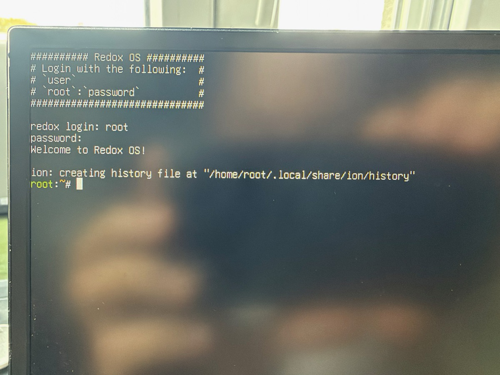
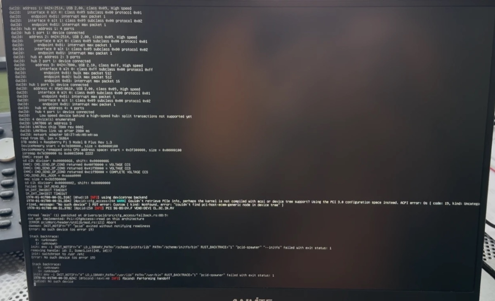
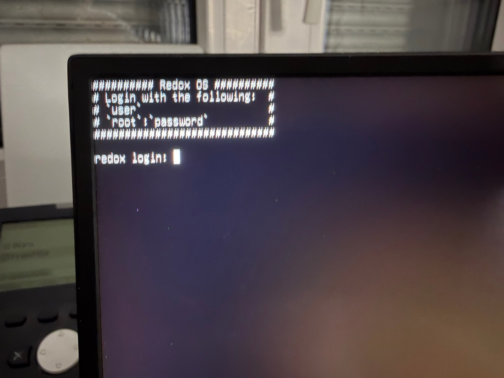
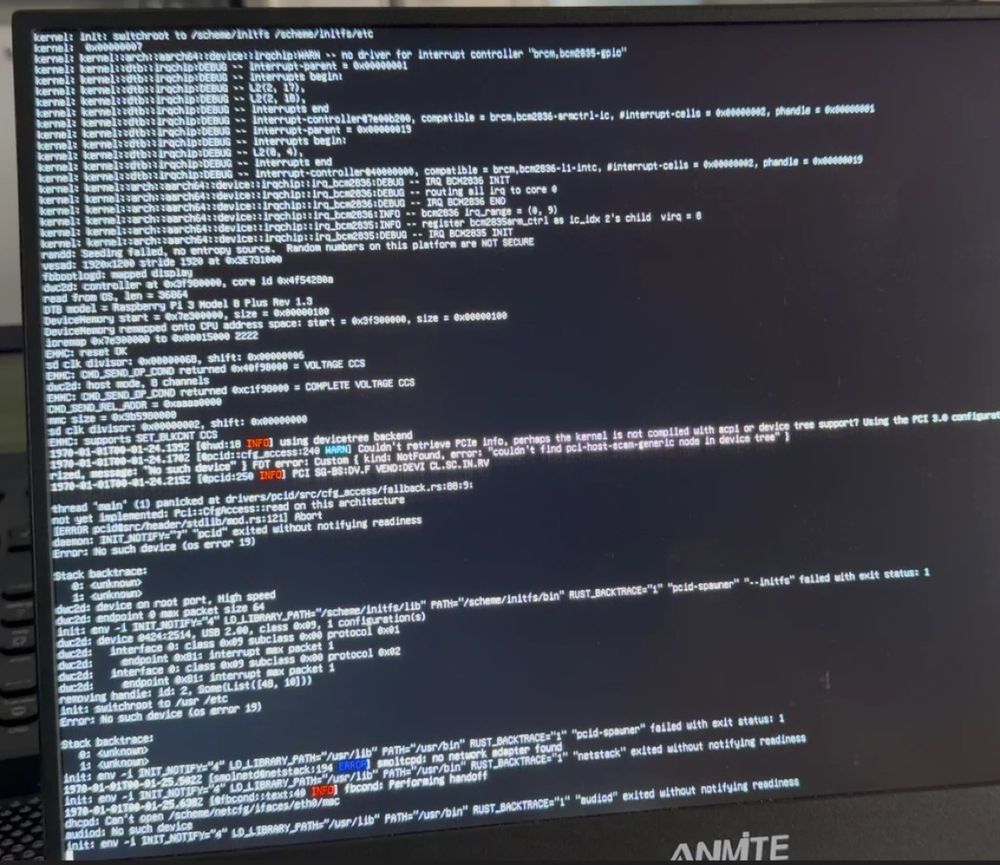

# Status and findings

Last update: 2026-10-24. Upstream revisions checked: redox `4338ac2`,
kernel `6cfaba5`, base `d2ffc4c`, relibc `5bfdd35`, bootloader `cc922ec`,
daily image `redox_server_aarch64_2026-10-24_565`.

## Findings: SD card and prebuilt programs (2026-10-26)

- **SD card on real hardware:** Redox' `bcm2835-sdhcid` failed reads on the
  Pi 3B+ after a while (`Timeout waiting for ready to read`, then
  `SR_DAT_INHIBIT TIMEOUT` for every transfer), and programs loaded from the
  card crashed, `login` first. The driver never reset the data line after an
  error and ran the card at 62.5 MHz (base clock assumed 41.67 MHz, the
  firmware gives 250 MHz). Patched: reset and retry, 12.5 MHz.
- **Prebuilt programs:** bash, nano, vim, tmux, ripgrep, curl, wget and gawk
  from Redox' aarch64 package repository stop at start with a `brk`
  exception (ESR `0xF2000001`), `find` fails to link; in QEMU as on the Pi.
  coreutils, ion, kibi and diffutils run. Not in our images for now.

## Milestone: USB keyboard on a real Pi 3B+ (2026-10-26)

Login and shell with a USB keyboard on the Pi's HDMI console. Every USB port
of the Pi 3B+ sits behind its high-speed hubs, so a low- or full-speed
keyboard is only reachable through a hub's transaction translator: `dwc2d`
now does split transactions, finds boot protocol keyboards and polls them on
their interrupt endpoint, and sends the key changes to `inputd` like
`usbhidd` does. US layout; held keys repeat. In QEMU, `scripts/test-keyboard.sh`
types on QEMU's USB keyboard through the monitor and checks the result
through `devshd`.



## Milestone: remote login on a real Pi 3B+ (2026-10-26)

`devshd` ([`tools/devshd`](../tools/devshd)) runs `login` on a pseudo-terminal
for every TCP connection on port 2323. From the build server, through the
router: `redox login: root`, `uname -a` → `Redox redox 0.5.12 … aarch64`,
`ps` (4 CPUs, `dwc2d`, `netstack`, `devshd`, `ion`), and
`/scheme/netcfg/ifaces/eth0/addr/list` → `192.168.178.148/24`. Port 2323 is
open about 80 s after power-on. Unencrypted: for the home network only,
until SSH works.

    socat -,raw,echo=0 tcp:<pi-address>:2323          # interactive
    scripts/devsh.py <pi-address> 2323 "uname -a"     # scripted

`reboot` (as root, [`tools/reboot`](../tools/reboot)) restarts the Pi. The
Pi 3 firmware has no PSCI, so the kernel patch resets it through the
BCM2835 watchdog, as Linux does.

## Milestone: Ethernet on a real Pi 3B+ (2026-10-26)

Redox on the Raspberry Pi 3B+ is on the LAN: `dwc2d` enumerates both onboard
hubs and the LAN7800, our LAN7800 driver brings up the chip and the PHY
(`link up after 2880 ms`) with the board's MAC address from the devicetree,
and Redox' `netstack`/`dhcpd` get `192.168.178.148` from the router. From the
build server, TCP connections to the Pi are refused instantly (RST from
Redox' TCP stack, no service listening yet) and ARP shows it `REACHABLE`.



## Milestone: first boot on real hardware (2026-10-25)



A Raspberry Pi 3B+ booted Redox over the network from the build server:
Pi firmware → our U-Boot v2026.10 (LAN7800, DHCP, TFTP) → compressed image
unpacked in RAM as a `blkmap` disk → patched live bootloader → our kernel →
`redox login:` on the HDMI screen (framebuffer inherited from UEFI). The USB
keyboard does not work in Redox yet (no DWC2 driver). The boot log scrolls
by on the screen before the login prompt and shows
`CPU activation complete: 4 CPUs online`: **SMP works on real hardware**.

## Summary

- Redox's latest daily **aarch64 server image boots in QEMU `raspi3b`** (an
  emulated Raspberry Pi 3) up to the login prompt and a root shell, **after
  fixing a kernel panic** in devicetree interrupt parsing (see below).
- Most programs started from the shell currently crash. This is a general
  bug in today's daily build (it happens on QEMU `virt` too), not a Pi issue.
- The Redox kernel **builds on macOS** (Apple Silicon) in under a minute with
  the pinned nightly Rust toolchain. A full image build still needs Linux.

## What exists upstream for the Pi 3

| Area | State |
|---|---|
| Build system | Board `raspi3bp`, only a `minimal` config (`config/aarch64/raspi3bp/minimal.toml`); `make qemu` knows QEMU `raspi3b` |
| Boot chain | Pi firmware → U-Boot (prebuilt 2022.07 from [redox_firmware](https://gitlab.redox-os.org/Ivan/redox_firmware), last change 2023-12) → Redox UEFI bootloader → kernel |
| Devicetree | Kernel reads the DT that U-Boot passes through UEFI. The prebuilt U-Boot uses its **own embedded Pi 3B DT** (`devicetree: embed`) |
| Interrupts | Drivers for `brcm,bcm2836-l1-intc` and `brcm,bcm2836-armctrl-ic` (kernel `src/arch/aarch64/device/irqchip/`) |
| Timer | ARM generic timer, works |
| Serial | PL011 only (`arm,pl011`). The mini UART (`brcm,bcm2835-aux-uart`) is not supported → `dtoverlay=disable-bt` is required so the PL011 is on GPIO14/15 |
| SMP | Upstream supports only PSCI with a GICv2, so **only 1 of 4 cores** runs. ✅ Fixed here: [`patches/kernel/`](../patches/kernel/) adds `spin-table` and BCM2836 IPIs, all 4 cores come up in QEMU |
| SD card | `bcm2835-sdhcid` (in `base/drivers/storage/`) for the Arasan controller `brcm,bcm2835-sdhci`. Only started on images built with `BOARD=raspi3bp` (`condition_board`) |
| USB / Ethernet | No DWC2 driver. Redox USB is xHCI only. No LAN9514/LAN7515/RTL8152 drivers |
| Reset / power-off | Not available (no PSCI node on the Pi) |

## Boot test in QEMU `raspi3b` (macOS, QEMU 11.1.2)

Reproduce with [`scripts/qemu-raspi3b.sh`](../scripts/qemu-raspi3b.sh).

1. **Unmodified daily image:** U-Boot → bootloader → kernel, then
   `KERNEL PANIC ... src/dtb/irqchip.rs:133:48: MissingRequiredProperty("interrupt-cells")`
   while parsing the GPIO node.
2. **With the fixed kernel:** boots to `redox login:`, login as `root` works,
   the `ion` shell runs. 408 MB RAM free after loading the 509 MiB live disk.
3. Commands like `uname`, `ls`, `cat`, `ps`, `free`, `df` crash immediately
   (see "relibc startup crash" below). `pcid` crashes at boot because there
   is no PCI bus (harmless, but noisy).

## Bug 1: kernel panic on the Pi's devicetree (fixed here)

**Cause:** Kernel commit `e595f73` (2026-10-17, "Update fdt crate") switched
to `fdt` rev `8fa4388`. In that version, a node without its own
`interrupt-parent` gets its **direct devicetree parent** as interrupt parent.
On the Pi, the GPIO controller's parent is the bus node `/soc`, which has no
`#interrupt-cells`; the real interrupt parent is inherited from the root node.
Linux (`of_irq_find_parent`) keeps walking up the tree until it reaches an
interrupt controller.

**Affected:** every Raspberry Pi 3 / Zero 2 W devicetree. Reproduced on the
host with the official `bcm2710-rpi-3-b.dtb`, `bcm2710-rpi-3-b-plus.dtb`
and `bcm2710-rpi-zero-2-w.dtb`. Redox's own hand-written Pi 3B+ DTS in
redox_firmware has no GPIO node and is not affected.

**Fix:** [`patches/fdt/0001-…`](../patches/fdt/) for the
[`fdt` crate](https://github.com/repnop/fdt) (third party, not part of Redox):
walk `interrupt-parent` links and devicetree parents until a node with
`#interrupt-cells` is found. Includes a regression test with a small
self-written DTS. All crate tests pass.

Use it in a kernel build with:

```sh
cargo rustc ... --config 'patch."https://github.com/repnop/fdt.git".fdt.path="<path to patched fdt>"'
```

## Bug 2: relibc startup crash (upstream, not Pi-specific)

Programs started from `ion` die with `brk #1` (ESR `0xF2000001`) in
`relibc_start_v1`, panic message `no filetable fd present`
(relibc `src/start.rs:183`). Same result on QEMU `virt` with `-cpu max` and
the unmodified kernel, so it is a general regression in the 2026-10-24 daily
build. Likely related to the `dup2` / filetable changes in relibc and base
this week. Next step: retry with a newer daily image or a self-built image.

## SMP: all four cores (fixed here)

Upstream starts secondary CPUs only through PSCI and sends IPIs only through
a GICv2. The Pi has neither: the firmware parks the cores in a spin-table
loop (`cpu-release-addr` 0xe0/0xe8/0xf0) and the BCM2836 local interrupt
controller delivers IPIs through per-core mailboxes.

[`patches/kernel/0001-…`](../patches/kernel/) adds:

- the `spin-table` enable method, with a trampoline entry that picks up the
  boot arguments from the trampoline page (spin-table passes no context),
- IPIs through mailbox 0 of the BCM2836, reported like GIC SGI IDs,
- per-core routing of all architected timer interrupts. Upstream could only
  enable the physical timer interrupt, not the virtual timer the kernel
  uses on Cortex-A53. On real hardware this may also matter for the boot
  CPU's scheduler tick.

Result in QEMU `raspi3b`: all secondaries pass the IPI/timer self-test,
`CPU activation complete: 4 CPUs online`, and the system boots to the login
prompt. Not yet tested on real hardware.

## Own image build (Linux host)

[`scripts/build-image.sh`](../scripts/build-image.sh) builds a `raspi3bp`
image on the x86_64 Linux host in about 25 minutes (first run, natively
without Podman): kernel, `base` and bootloader from source with our patches
and `BOARD=raspi3bp`, the rest from Redox's prebuilt packages or built by the
cookbook. Result: a 256 MiB image (126 MiB RedoxFS).

In QEMU `raspi3b` it boots **without live mode** in 24 seconds (on the Linux
host): `bcm2835-sdhcid` drives the SD card and `redoxfs` mounts the root
filesystem from it. `ps` shows the processes spread over all four CPUs.
`uname`, `ls` and `ps` work; `df` and `free` still crash with the relibc
`no filetable fd present` panic, and `cat /scheme/sys/cpu` faults with
"Write, but grant was not PROT_WRITE".

## USB: dwc2d, first stage

Redox has no driver for the DWC2 USB controller of the Pi 1-3 and Zero, so
no keyboard and no Ethernet. [`patches/base/`](../patches/base/) adds
`dwc2d`, written from scratch in Rust (references: QEMU's DWC2 model and the
BSD drivers; Linux only for understanding, nothing copied). First stage:

- finds the controller in the devicetree, resets the core, forces host mode,
  sets up the FIFOs, buffer DMA (bus address = physical | 0xC0000000)
- powers and resets the root port, detects the device speed
- control transfers on channel 0, polled: reads the device and
  configuration descriptors, assigns address 1

In QEMU `raspi3b` it enumerates the device on the root port: QEMU's
`usb-hub` (`0409:55aa`, class 0x09), with the keyboard behind it.

**On the real Pi 3B+** it enumerates the onboard hub (2026-10-25): core
`0x4f54280a` (DWC2 v2.80a; QEMU models v2.94a), device on the root port at
high speed, endpoint 0 max packet 64, device `0424:2514`, USB 2.00, class
0x09 with the single-TT and multi-TT alternate settings.



**Hubs** (second stage): `dwc2d` configures hubs, powers and resets their
ports and enumerates the devices behind them, recursively. In QEMU it finds
the keyboard behind QEMU's hub: `0627:0001`, HID boot keyboard (class 0x03,
subclass 0x01, protocol 0x01) with an interrupt endpoint `0x81`. Full and low
speed devices behind a high-speed hub (keyboards on the real Pi) still need
split transactions and are skipped with a message.

**Network** (third stage, 2026-10-26): bulk transfers on separate channels
(one receive transfer kept pending) and a CDC Ethernet (ECM) adapter on top
of `driver-network`, running inside `dwc2d`. In QEMU `raspi3b` with
`scripts/qemu-raspi3b.sh --usb-net` (QEMU's `usb-net` behind its hub, next
to the keyboard) Redox gets `10.0.2.15/24` by DHCP and pings `10.0.2.2` with
0 % loss: the whole path from USB to the network stack works.

Two Redox pitfalls found on the way: an initfs daemon that sleeps after init
switched to the real root filesystem never wakes up, and printing from it
after boot can block. The poll loop therefore yields and stays silent (one
busy core until the driver uses interrupts).

Next: the LAN7800 (Pi 3B+) and RTL8152 (Zero 2 W HAT) on the same bulk
transfers; interrupts; split transactions for keyboards behind high-speed
hubs; the `xhcid` scheme interface for `usbhidd`.

## Implications for the Zero 2 W

- **512 MB RAM rules out live mode** with the server image (509 MiB). The
  Zero 2 W needs a smaller image in live mode, or the SD card driver.
- The prebuilt U-Boot embeds a Pi 3B DT. For the Zero 2 W we need a U-Boot
  that uses the firmware's DT (upstream `rpi_arm64_defconfig`, `OF_BOARD`),
  or a Zero 2 W build.
- In the official Zero 2 W DT the SD card is on `sdhost`
  (`brcm,bcm2835-sdhost`, `mmc@7e202000`) and the Arasan controller that
  Redox's driver uses is `disabled`. Either route the SD card to the Arasan
  controller (Pi firmware overlay `dtoverlay=mmc`, to be verified) or write
  an sdhost driver.
- The DWC2 USB controller is `disabled` in the base DT and is enabled by the
  firmware (`dtoverlay=dwc2` or `otg_mode=1`, to be verified).

## Tools in this repository

- [`tools/redoxfs-file`](../tools/redoxfs-file): read or replace a file in the
  RedoxFS partition of an image, without FUSE (works on macOS).
- [`scripts/build-kernel.sh`](../scripts/build-kernel.sh): build the latest
  upstream kernel with this repository's patches (macOS and Linux).
- [`scripts/qemu-raspi3b.sh`](../scripts/qemu-raspi3b.sh): download the latest
  daily server image, optionally inject a kernel, boot in QEMU `raspi3b`;
  `--test` checks the console output automatically.
- CI ([`.github/workflows/qemu-boot.yml`](../.github/workflows/qemu-boot.yml)):
  builds and boot-tests on every push and daily against the latest upstream.
