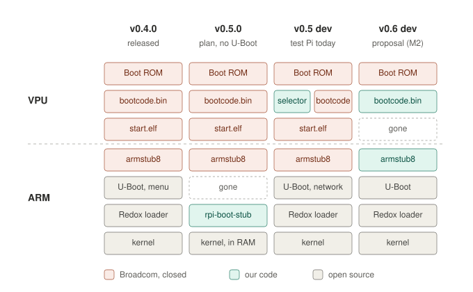
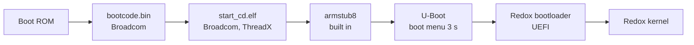
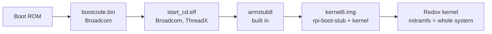
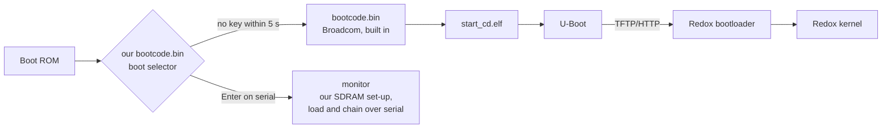
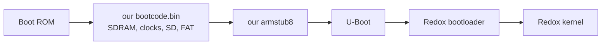
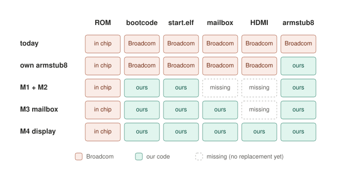

# Boot chain by release (draft)

**Draft, 2026-11-11.** This page puts in one place which pieces start
Redox on the Pi 3B+ in each release, which of them come from Broadcom,
and where we are heading. The details stay where they are: per-piece
reference in [architecture.md](../architecture.md#what-runs-where), day-to-day
state in [boot.md](boot.md), the firmware work in
[open-firmware.md](open-firmware.md). The v0.6.0 and end-goal sections are
proposals; the maintainer decides them (#230, #333).

## The Broadcom pieces and what we know about them

The Pi has two kinds of processor: the **VPU** (VideoCore IV), which
starts first and owns clocks, memory and display, and the four
**ARM Cortex-A53** cores, where Redox runs.

| Piece | Runs on | Source | What we know | Do we still need it? |
|---|---|---|---|---|
| Boot ROM | VPU | in the chip, closed | Looks for `bootcode.bin` on SD, then USB or the network (network boot is in ROM on the 3B+). Loads at most 128 KiB into the L2 cache at `0x80000000` and jumps to `0x80000200`. Never writes the OTP. | Yes, always: it cannot be replaced, and it cannot be broken either. |
| `bootcode.bin` | VPU, L2 cache | closed, 52 KB (1.20260915) | Sets the PLLs and brings up the 1 GB SDRAM, then loads `start*.elf`. We have behaviour notes from an internal disassembly (register order and values, not published). Our M1 does the same job and passed on the Pi. | Today yes. Our own one (M1) works; see v0.5 dev below. |
| `start_cd.elf` + `fixup_cd.dat` | VPU, SDRAM | closed; ThreadX RTOS | Reads `config.txt`, sets clocks, splits memory (`gpu_mem=16` picks the cut-down `_cd` variant), sets up HDMI and the framebuffer, fills in the devicetree (memory, MAC, serial), loads the kernel, starts the ARM. **Keeps running** and answers the mailbox (below). `fixup*.dat` is the relocation data that matches the memory split. | Yes. This is the big one: replacing it is #230 M2 to M4. |
| `armstub8` | ARM, EL3 | built into `start*.elf`; source BSD ([`armstub8.S`](https://github.com/raspberrypi/tools/blob/master/armstubs/armstub8.S)) | Timer frequency, SMP bit, EL3 to EL2, parks cores 1–3 in the spin table. | Our own build of the BSD source (`armstub8-redox.bin`) booted on the Pi; not used by any image yet. |
| Devicetree `bcm2710-rpi-3-b-plus.dtb` + overlays | read by the firmware | open (Raspberry Pi Linux tree) | Hardware description; the firmware adds memory size, MAC and serial at boot. | Yes, but it is open source. |
| `LICENCE.broadcom` | – | – | The terms under which the closed files may be passed on. | Must ship with every card that carries Broadcom files. |

**What `start.elf` does after boot (the mailbox).** Several of our parts
ask the running VPU firmware for things over the mailbox property
interface. Each of these breaks the day `start.elf` is gone, unless our
own VPU code answers instead (#230 M3, M4):

| Who asks | For what |
|---|---|
| U-Boot | board revision, memory size, MAC address |
| `rpi-boot-stub` (direct boot) | switch the USB power domain on |
| `rpi-firmwared` | temperature, throttling, clocks, ARM clock 600 → 1400 MHz |
| CPU governor (`/etc/rpi-firmware/governor`) | ARM clock changes |
| `rpi-fbd` (console, desktop) | the framebuffer |
| `rpi-update` | the tryboot flag |

Not part of the boot, but also a Broadcom/Cypress blob: the Wi-Fi chip's
firmware, for the day the Wi-Fi theme starts.

## Releases

### v0.4.0 (released): firmware → U-Boot → Redox bootloader → kernel

- All four firmware pieces are Broadcom's, from the SD card.
- U-Boot shows the boot menu (#243) and starts the card's entry after 3 s;
  the other entries are network boot for our test network.
- The Redox bootloader reads RedoxFS from the card's second partition.
- `config.txt`: `arm_64bit=1`, `kernel=u-boot.bin`, `gpu_mem=16`.

### v0.5.0 (plan, cut-off 2026-11-13): firmware → kernel, no U-Boot

- Maintainer decision on #324: the release card boots straight from the
  firmware (direct boot, #15, on main since PR #183), if the Pi 3B+ and
  Zero 2 W tests pass by the cut-off. Otherwise v0.5.0 ships the U-Boot
  card of v0.4.0 and this moves to v0.6.0.
- `config.txt` changes to `kernel=kernel8.img` and
  `initramfs initramfs followkernel` (`make-sdcard.sh --direct`).
- The whole system runs from RAM (about 222 MiB); the FAT partition is
  reached through `fatfsd`.
- The firmware is still all Broadcom. What goes away is U-Boot and the
  Redox bootloader: faster start, fewer pieces.

### v0.6.0 or later (not decided)

There is no v0.6.0 milestone yet. Candidates:

- Direct boot, if it misses v0.5.0.
- `rpi-update` with tryboot and the watchdog fallback (Pi test #72).
- Our own `armstub8` (the BSD source, built by us) instead of the one
  inside `start.elf`: `armstub=armstub8-redox.bin` in `config.txt`. It
  booted on the Pi; one more test with `uart_2ndstage=1` should show
  that the firmware really loaded ours.
- Our own `bootcode.bin` in a release card gains nothing yet: it can hand
  over to Broadcom's chain only before it sets up the SDRAM. After our
  SDRAM set-up, Broadcom's `bootcode.bin` fails (#269, #313, #320), and
  starting Broadcom's `start.elf` straight from ours is untested. So the
  first release with our VPU code needs our own replacement for
  `start.elf` too, at least for booting (M2).

## Development (test Pi)

### v0.5 dev: the test Pi's network boot card

- Only on the test Pi, not in any image. The card's `bootcode.bin` is our
  boot selector (repository `redox-rpi/rpi-open-firmware`, branch
  `autoboot`, PRs
  [#2](https://github.com/redox-rpi/rpi-open-firmware/pull/2),
  [#3](https://github.com/redox-rpi/rpi-open-firmware/pull/3),
  [#5](https://github.com/redox-rpi/rpi-open-firmware/pull/5) waiting).
- Without a key it chains Broadcom's `bootcode.bin` before touching the
  SDRAM, and the Pi boots exactly as before: U-Boot then fetches the
  current image from homenodellm (see [netboot.md](../netboot.md)).
- With Enter on the serial console it keeps our monitor: our own SDRAM
  set-up (1 GB, tested), and firmware test programs loaded over the
  serial line. `reset` (watchdog) returns to the normal boot. Firmware
  tests no longer need a card swap.
- Direct-boot test cards for #324 are built from the same main
  (`redox-rpi-direct-3bp-…`, `redox-rpi-direct-zero2w-…`).

### v0.6 dev target (proposal)

#230 M2: our `bootcode.bin` loads a 64-bit ARM stub, U-Boot and the
devicetree from the SD card and starts the ARM itself, with no Broadcom
code at all after the Boot ROM, chosen from the selector's monitor:

What breaks on this path until M3 and M4 exist: U-Boot's mailbox
questions (MAC, memory), `rpi-firmwared`, the CPU clock (the ARM stays
at its start clock), and the console and desktop on HDMI. Serial console
and the network (with a fixed MAC) should work. This is development
only; it is not a release path until M3 (the mailbox service) exists.

Alternative to building all of it ourselves: check how far librerpi
(lk-overlay, which already runs as a VPU RTOS and replaces `start.elf`)
gets on the 3B+, and chain it from the monitor the same way (#333).

## End goal (maintainer's decision)

#230 states the goal: replace **all** of Broadcom's closed boot pieces;
only the Boot ROM stays. In steps:

| Step | Replaces | Then open | Still Broadcom |
|---|---|---|---|
| today | – | U-Boot, bootloader, kernel, devicetree | ROM, `bootcode.bin`, `start.elf`, `armstub8` |
| own `armstub8` | built-in stub | + ARM stub | ROM, `bootcode.bin`, `start.elf` |
| M1 + M2 | `bootcode.bin`, `start.elf` for booting | + all boot code | ROM; no mailbox, no HDMI, ARM at start clock |
| M3 | `start.elf` at run time (mailbox) | + clocks, temperature, MAC | ROM; no HDMI |
| M4 | display | + framebuffer, console, desktop | ROM only |
| M5 | 3D, network boot in our firmware | + V3D power and clock | ROM only |

"100 % open source" is therefore not reachable on this hardware: the
Boot ROM is part of the chip, and Wi-Fi would add another blob. "No
Broadcom code after the Boot ROM" is reachable at M4 for the console
and desktop, and at M5 for 3D.

Open questions for the maintainer:

- Whether the firmware becomes a project of its own (#333).
- Whether we build M2 to M4 ourselves or base them on librerpi.
- From which release a card may carry our firmware: only once M3 and M4
  are done, so nothing gets worse for users, or earlier as an
  experimental card.
